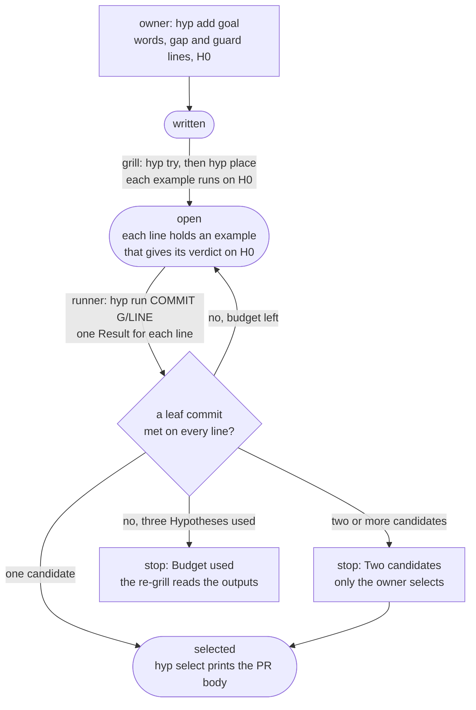

# hyp

Requirements as examples for AI coding agents. You write a Goal one time: one sentence of words, and the lines that a build must make true or keep true. An agent writes examples that test each line, and a second agent builds commits. hyp runs each example, keeps each verdict in an append-only log in your repository, and selects only a commit that meets every line.

## Why hyp exists

When an owner gives requirements to an AI coding agent, the work has two phases. First, the agent decides a design. Then, it builds the design. In both phases, the agent decides alone, and it reports in its own words:

- **In the design phase,** the agent usually takes the first design that seems to work. It seldom compares that design with other options, or tests which option meets the requirements. Its reasons stay in notes, plans and chat.
- **In the build phase,** the agent says "done". Its proof stays in the chat: which commit it tested, which check failed before the change and passed after it, and what the review found.

The notes become too long to read, and the next session does not see the chat. A new session cannot find which decisions are made and which decisions are open. Thus it starts again, or it uses a summary that it cannot examine. The owner also cannot examine whether the result meets the requirements.

Other authors already wrote skills for each part of this problem. hyp starts from their skills:

- **[pstack](https://github.com/cursor/plugins/tree/ae5650febf4320793844c12c4adaa937f417f8da/harness/pstack)**, from Cursor. For the record of decisions, its `show-me-your-work` skill keeps an append-only decision log. For the proof that work is done, its `create-verification-skill` skill operates the real app with a fixed procedure and honesty rules.
- **[Matt Pocock's skills](https://github.com/mattpocock/skills)**. For the requirements, their `grilling` skill interviews the user in rounds over a design tree, until the user and the agent have a shared understanding.

These skills work well, and hyp keeps their rules. But each skill solves one part alone. hyp adds what the work needs when the parts must connect, across many sessions and without the owner: one Goal for the design and the build, with one set of rules:

- **The requirements become the lines of a Goal.** The owner writes the words and the lines one time. A `gap` line is false on the base commit, and the build must make it true. A `guard` line is true on the base, and the build must keep it true.
- **Examples make each line testable.** The grill writes one or more examples for each line. hyp places an example only when it gives its line's verdict on the base, H0: a gap example fails there, and a guard example is met.
- **A Hypothesis is a commit.** The runner builds commits and runs each line on them. A commit holds the build and, under `goals/<Goal>/specs/`, the spec of its design.
- **The select is the gate.** hyp records a select only for a commit that is met on every line and holds a spec. A budget of three Hypotheses limits each run, and hyp calculates where the run stops.

Layers 1, 2 and 3 below each name the idea that hyp took, the gap that stays for this purpose, and the rule that hyp adds. Layer 4 closes a gap that hyp found in its own use. [docs/state-machine.md](docs/state-machine.md) is the one spec of every rule.

### The Goal at a glance

The owner records a Goal, the grill places its examples, and the runner runs commits until hyp calculates a stop:



### 1. A log that each state comes from

The hyp record comes from the pstack skill [`show-me-your-work`](https://github.com/cursor/plugins/blob/ae5650febf4320793844c12c4adaa937f417f8da/harness/pstack/claude-code/skills/show-me-your-work/SKILL.md). That skill keeps a decision log: one TSV row for each decision, with its reason, its evidence and its result. The log is append-only. A new row supersedes a wrong row, and nobody edits or deletes a row.

hyp keeps the append-only log. But a row states its result in words, and a later session must find the current state without a summary. hyp closes each gap with one rule:

| In the decision log | The rule in hyp |
|---|---|
| A row states its result in words. | **hyp calculates each state.** A Goal is `written`, `open` or `selected`, and a commit is a candidate or not. hyp calculates each state from the events on each command. No command sets a state. |
| Each row stands alone. | **Git gives the lineage.** Each Result names its commit. hyp reads the commit ancestry, and only a leaf, a commit that no other run of the Goal descends from, can be a candidate. |
| The log is local, and you commit it only when a reviewer needs it. | **The log is the source of truth.** Each act that writes appends one event to `.tree/events/<actor>.jsonl`. You commit the log with the work. Git merges two branches of one events file by keeping every line of both. |
| A new session reads the rows to find the current state. | **`hyp status` prints the state and the next acts.** For each role, it prints the allowed acts as ready command lines. An agent runs a line that hyp printed. |
| The log does not keep what the agent read. | **hyp keeps what it printed.** hyp keeps a trace of each output that it printed to an actor, under `~/.hyp/traces`, outside the repository. `hyp show ACTOR` prints it byte for byte. |

hyp reads git, and it writes no refs, objects, config or index. The owner and the agents commit.

### 2. Examples that you can repeat

The quality of a Goal depends on the examples that test its lines. The hyp example comes from the pstack skill [`create-verification-skill`](https://github.com/cursor/plugins/blob/ae5650febf4320793844c12c4adaa937f417f8da/harness/pstack/claude-code/skills/create-verification-skill/SKILL.md).

That skill makes a verify skill for one project. The verify skill tells an agent how to operate the real app as a user does, and how to prove that a feature works. It has five sections: Launch, Doctor, Drive, Evidence and Cleanup. It also has these honesty rules:

- Evidence stays after cleanup.
- A step that you prove only in a stand-in for the real target stays unverified.
- You must not make a journey easier so that it passes.
- A verify skill that nobody ran is a draft.

hyp keeps the fixed procedure that operates the real subject, and it keeps the honesty rules. But a verify skill answers one question: "Does this feature work?" A hyp example answers a different question: "Does this commit meet this line?" Also, a later session must be able to examine that answer. hyp closes each gap with one rule:

| In a verify skill | The rule in hyp |
|---|---|
| A proof is about one feature. | **One example for each case of a line.** An example folder, `goals/<Goal>/<line>/<example>/`, holds the owner's words for one case, the command to run, its input files and a Probe. A line can hold many examples. |
| The agent decides after the run whether the evidence is a proof. | **The verdict is set before the run.** The example states literal floors and ceilings for the output. An example is met when its output holds every floor and contains no ceiling. Nobody reads the output to decide. |
| The agent runs each command. The record of the run is the report of the agent. | **hyp runs the Probe.** hyp runs the example's Probe on a fresh copy of the commit's files, extracted by hash. It stores each output under `.tree/outputs/` by its sha256. Two runs on the same bytes must give one verdict. |
| The skill proves itself one time, when the agent makes it. | **An example must fail first.** hyp places an example only after it runs on H0: a gap example must fail there, and a guard example must be met. `hyp try` shows that verdict before the place, and records nothing. |
| A journey can become easier so that it passes. | **An example only becomes stricter.** A new version of an example can only add floors or ceilings. A changed command, input or Probe is a new example. |

### 3. A grill that leaves a Goal for another session

An unattended run can stop only when the Goal holds each decision of the owner. The hyp grill makes that Goal before the run. It comes from the [`grilling`](https://github.com/mattpocock/skills/blob/7739eaed7f8f3915437a8def198a6d0d7206dbc7/skills/productivity/grilling/SKILL.md) skill of Matt Pocock.

That skill interviews the user about a plan until the user and the agent have a shared understanding. It keeps the decisions as a design tree. The frontier is each decision whose prerequisites are settled. The agent works in rounds:

- Each round asks the full frontier. Each question has a number and a recommended answer.
- The agent finds facts itself, or a subagent finds them. It never asks the user for a fact.
- The decisions are the user's. The agent puts each decision to the user and waits.
- The session is done when the frontier is empty. The agent does nothing until the user confirms the shared understanding.

hyp keeps the split between facts and decisions, and each decision stays the owner's. But the grilling skill makes a shared understanding in one chat. The hyp grill must make a Goal that a different session can run without the owner. The [hyp-grill](skills/hyp-grill/SKILL.md) skill closes each gap with one rule:

| In the grilling skill | The rule in hyp |
|---|---|
| The result is a shared understanding in the chat. | **The grill writes the examples.** The grill drafts the words and the lines, and the owner records the Goal. The grill writes each example, runs `hyp try`, commits it and places it. |
| Each decision is in the chat. | **A decision is the words, a line or an example.** The grill reports a decision that no example checks under "Not covered" in its hand-off. It never gives that decision to the runner as an extra rule. |
| The agent puts each decision to the user. | **Product questions only.** The grill asks what the owner wants to be true, never how to build it. Each option says what the runner must build, and the cheapest build that meets it. |
| The same session acts on the result. | **A separate runner, with run rules.** A runner in another session works the Goal. It follows [run-rules.md](skills/hyp-grill/run-rules.md), the rules that hyp cannot check. |
| The session is done when the user and the agent agree. | **A re-grill after a stop.** At a stop for the owner, the re-grill reads the table of outputs. It makes an example stricter, or a new Goal holds a new line. |

### 4. The select is the gate

A recorded verdict does not show when the work is complete. Also, an agent can try builds until one passes by chance. hyp adds these rules:

- **Only a candidate can be selected.** A candidate is a leaf commit that is met on every line. With one candidate, the runner selects it. With two or more, only the owner selects.
- **The selected commit holds a spec.** hyp refuses a select of a commit with no file under `goals/<Goal>/specs/`.
- **The budget is three Hypotheses.** Each distinct tree that the runner runs is one Hypothesis, and H0 does not count. hyp refuses a fourth. A placement that changes an example starts the count again.
- **The report of the select is the PR body.** It holds each line, and each example's words, output, stderr, exit code and verdict. It also holds the selected commit and row. hyp writes nothing to GitHub.

hyp calculates three stops:

| Stop | Holds when | What hyp prints |
|---|---|---|
| Selected | The Goal has a select. | The PR body. |
| Two candidates | Two or more candidates, and no select. | The table of outputs: rows by examples. |
| Budget used | Three Hypotheses counted, and no candidate. | The table of outputs: rows by examples. |

## Who does what

Each act needs an actor (`--actor` or `$HYP_ACTOR`). Each act that writes also needs a role (`--role` or `$HYP_ROLE`). The actor and the role are declared by the agent. A guard that reads them catches an honest mistake, not a lie.

| Role | Does | Acts |
|---|---|---|
| **owner** | Writes the words and the lines one time. Selects when two or more candidates meet every line. | `hyp add goal`, `hyp select` |
| **grill** | Asks the owner product questions. Writes the examples, and places them on the lines. | `hyp try`, `hyp place` |
| **probe-writer** | Writes Probe code for an example. It records no event. | none that writes |
| **runner** | Builds commits, runs each line on them, and selects the one candidate. | `hyp try`, `hyp run`, `hyp select` |
| **hyp** | Runs each Probe, calculates each state, and refuses an act whose guard fails. A refusal is exit 1 and names the guard. | |

`hyp status`, `hyp try`, `hyp show` and `hyp prune` are reads. They record nothing in the repository. Run `hyp help` for every command.

## Examples

hyp's own changes are made this way. Each Goal below is in this repository under [goals/](goals/), and `hyp status <Goal>` prints its state.

### A build Goal: G-H7GGGK

Goal G-H7GGGK added the hyp-grill skill. Its words and its one line:

```text
words:  A grill skill that ships with hyp
line-1 (gap): A user of hyp in another repository can grill and re-grill a Goal
              with no prompt written by hand.
```

The grill placed three examples on line-1: `line-1/a` "The skill covers the grill and the re-grill.", `line-1/b` and `line-1/c`. Each example runs a check script over the skill folder. On H0 (`f93b747`) the folder did not exist, so each example failed. Part of the output of `line-1/a` on H0:

```text
skill folder hyp-grill: no
rule option-label-is-the-recorded-text: no
...
hyp commands that hyp help does not list: none
```

The runner built commit `84fc46e` and ran line-1 on it. Each example was met, so the commit was the one candidate, and the runner selected it. `hyp status G-H7GGGK` prints the PR body (lines selected from its output):

```text
G-H7GGGK  selected  runs: 1 of 3 used
stop: selected
...
## line-1 (gap): A user of hyp in another repository can grill and re-grill a Goal with no prompt written by hand.

### line-1/b: The skill gives the runner the short list of run rules hyp cannot check, as a part beside it, not a second skill.

verdict: met, exit 0
...
selected commit: 84fc46ea7054a2f9116b10039f735a0f488ffb75
selected row: 8326335b3416ae83ee1cab190b66a82965950e89
```

### Gap and guard lines: G-RK4VYD

Goal G-RK4VYD moved the trace into hyp's own folder. It has two gap lines and one guard line:

```text
line-1 (gap):   hyp keeps the trace under ~/.hyp/trace or something similar, and does
                not hijack the ~/.local folder.
line-2 (gap):   The owner can see and remove the traces of repositories that no
                longer exist.
line-3 (guard): The owner can read an agent's reads from any git worktree of the
                clone the agent used, before its branch merges.
```

The four examples of the gap lines failed on H0. The one example of line-3 was met on H0, and it had to stay met on the build. The selected commit, `3dd9a3a`, added `hyp prune` for line-2.

## Get started

Claude Code is the only harness hyp has been verified on.

**1. Install the binary** (needs Go):

```bash
go install github.com/dat9uy/hyp/cmd/hyp@latest
hyp version   # hyp 0.2.0-dev (events v2)
```

**2. Copy the grill skill into your project** and commit it, so each session in the project loads it. From your project's root, with a checkout of hyp at `<hyp>`:

```bash
mkdir -p .claude/skills
cp -R <hyp>/skills/hyp-grill .claude/skills/
git add .claude/skills
```

**3. Grill the Goal.** Start a session in your project, set `HYP_ACTOR` to a name for the agent and `HYP_ROLE=grill`, and ask it to use the hyp-grill skill on your problem. The grill asks you product questions and drafts the words and the lines.

**4. Record the Goal yourself.** The words and the lines are yours. They are frozen when the Goal opens, so take your time over them:

```bash
export HYP_ACTOR=<your-name> HYP_ROLE=owner
hyp add goal --base HEAD --words "<one sentence>" \
  --line "gap:<what the build must make true>" \
  --line "guard:<what the build must keep true>"
```

The first `hyp add goal` makes the store, `.tree/`, at the top level of the repository. Commit `.tree/` with the work. Then the grill writes the examples and places each one with the line that `hyp status <Goal> --role grill` prints.

**5. Run the Goal.** Give a runner session [run-rules.md](skills/hyp-grill/run-rules.md) and `HYP_ROLE=runner`. The runner builds on a branch, and runs only the lines that `hyp status <Goal> --role runner` prints. When hyp stops the Goal for you, `hyp status` shows why.

[docs/install.md](docs/install.md) has the full setup. To work on hyp itself, see [install.md, "Develop hyp"](docs/install.md#develop-hyp).

## What is in this repository

What you install is **core**: the binary (`cmd/`, `internal/`), the skill under `skills/hyp-grill` and the docs (`docs/`). The Goals that changed hyp itself are under `goals/`, and their store is `.tree/`. You need none of them to use hyp. [core-and-self-review.md](docs/core-and-self-review.md) maps each item to its scope.

## Status

hyp is experimental (version 0.2.0-dev, events v2). One author builds and tests it. Claude Code is the only harness it has been verified on; Codex and pi are untested. The evidence that it works is the selected Goals under `goals/`, each with its examples, outputs and verdicts in the store. [docs/state-machine.md](docs/state-machine.md) also specifies acts that hyp does not have yet; `hyp help` lists the acts it has.

hyp 0.1.0 (events v1) ran an investigation as a tree of rival Hypotheses, with recipes, sandboxes, Experiments and an owner flow of five skills. Its skills, recipes and recorded trees are kept on the `v1` branch. Records made before the public release stay in the private development history.

hyp itself changes only when a real event shows a failure. The change is then a Goal like any other.

## Contributing

Read [AGENTS.md](AGENTS.md). It explains the two scopes, how hyp is improved with hyp, and how to build and test.
