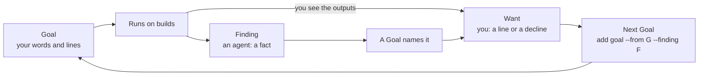
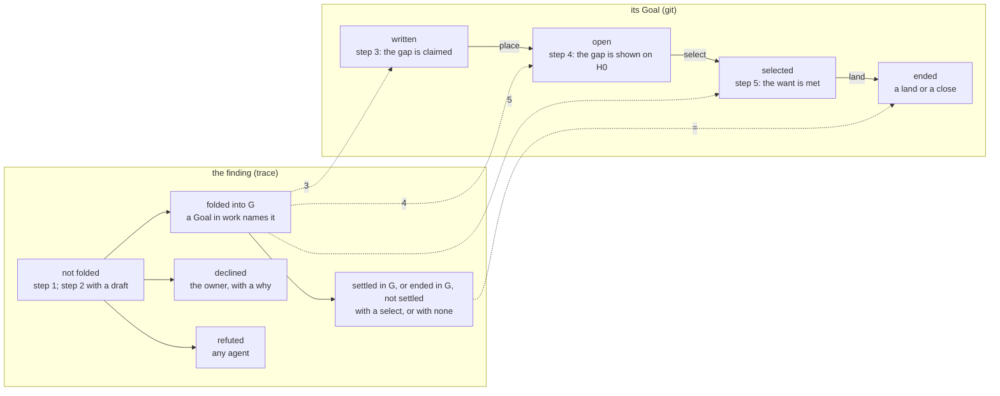
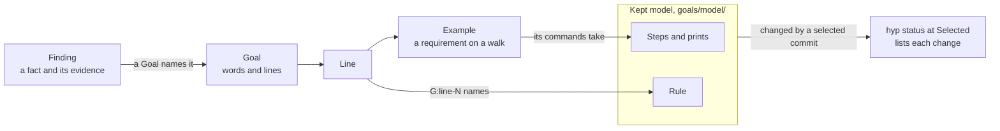
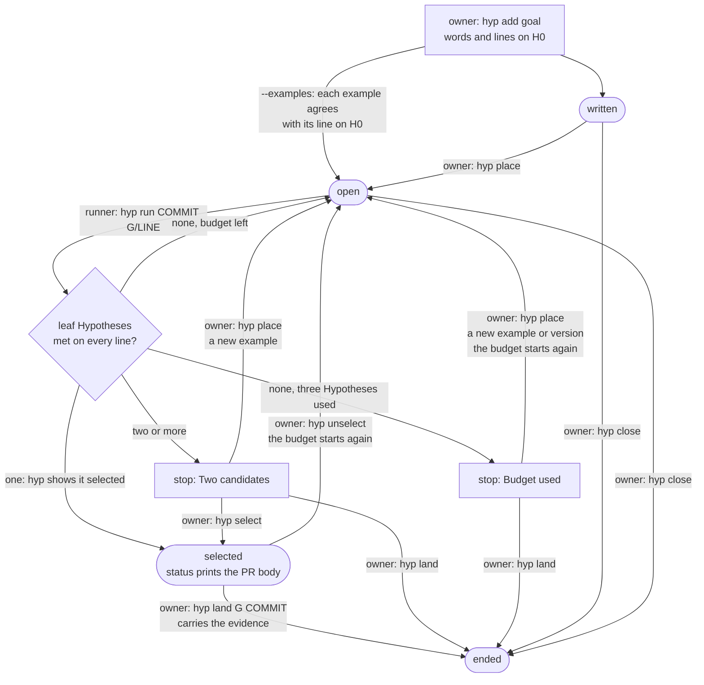

# hyp

Write examples of done first. Each change an AI coding agent makes stays a guess until they pass.

You write a Goal: one sentence of what you want, and the lines that a change must make true or keep true. An agent writes examples for each line: a command, and the text that its output must hold. Each build that an agent offers is a Hypothesis. hyp runs the examples on it and records each verdict. A build is selected only when it meets every line, and the report of that select is the PR body.

## Why hyp exists

When you give a change to an AI coding agent, the agent decides alone when the work is done. It says "done" after a check that it chose. Often that check passes on the old code too, so it shows nothing about the change. The agent can also try again and again until a check passes by chance.

What the work teaches is lost too. Two parties learn, and both lose what they learn:

- **The agent sees facts that nobody asked about.** It finds a bug next to the one it fixes, or a document that is out of date. It writes the fact in a chat, and the chat ends with the session.
- **You find out what you want only after you see a result.** Before the first build, you cannot state every case. After a few builds, you see what is wrong. That knowledge stays in your head or in a chat.

So the next session starts from less than the last one knew. It cannot find which decisions are made and which are open, so it starts again or trusts a summary.

## The rules hyp follows

hyp moves the decision about "done" out of the agent and into five rules:

- **You state what must be true before any build.** The Goal's lines are written against the base commit, H0. A `gap` line is false on H0, and the build must make it true. A `guard` line is true on H0, and the build must keep it true. The lines are frozen once the Goal opens.
- **An example counts only if it can fail.** hyp runs each example on H0 before it accepts it. The example must agree with its line there: a gap example fails on H0, and a guard example is met. A check that gives one answer whatever the code does teaches nothing.
- **Each build is a Hypothesis.** A Hypothesis is the subject of a commit: its files without `goals/` and `.tree/`. hyp keys it by its subject hash, so commits with the same subject are one Hypothesis.
- **Verdicts are calculated, not argued.** An example is met when its output holds every literal floor and contains no ceiling. hyp calculates every state from recorded events.
- **hyp stops the loop.** A Goal gets three Hypotheses beside H0. Then, or when a build meets every line, hyp stops the Goal for you.

These rules come from two older ideas. **Specification by Example** agrees on concrete examples before the build and runs them as tests. **Bayes** reads the same loop as belief and evidence:

| In Bayes | In hyp |
|---|---|
| The prior is stated before the evidence. | You state H0 and the lines before any build. |
| Evidence counts only if it could give either answer. | H0 shows that an example can fail. A build shows that it can pass. |
| The update follows a rule. | A literal compare gives each verdict, and hyp calculates each state. |
| Updating never ends by itself. | The budget and the stops end the loop, and the owner decides. |

hyp calculates no probability. A verdict is `met` or `failed`, and a build with no run reads `not run`.

## What is learned, and where it is kept

hyp keeps a record only for what someone learned from it. Three things are learned, by three parties:

- **An agent finds a fact.** A fact says what is, with a pointer to its evidence. The agent records it with `hyp finding add` as soon as it finds it. A finding names no Goal.
- **A Goal names the findings that bear on its want.** You name a finding when you add the Goal, with `hyp add goal --finding F`. The grill names it in an example. That name is the fold: a state of the finding, not an act.
- **You learn a want.** You see a consequence, such as an output, a stop or a finding. Then you state a want: a line of a new Goal, or a decline of a finding that you do not want fixed. Only you add a want. An agent can show a fact and ask.

An issue tracks the process toward a want: the event, your decisions and the split into Goals. The want itself is a Goal, a snapshot of it at the moment you add it. The issue closes when each want it tracks is held by an added Goal.

The loop joins the three:



One want passes through five steps, and each step adds one record. A finding and its Goal are two machines. The fold joins them: the finding is folded while its Goal's record names it.



hyp calculates each state, and `hyp finding list` and `hyp status G` print them:

| Step | Goal state | What names the finding | The finding reads |
|---|---|---|---|
| 0. A part | none | Nothing. An issue tracks the want, in your words. | none |
| 1. A finding | none | Nothing | `not folded` |
| 2. A drafted finding | none | Nothing. Its draft may hold an `add goal` for you to edit and run. | `not folded` |
| 3. A written Goal | `written` | The Goal: you, with `add goal --finding F` | `folded into G` |
| 4. An open Goal | `open` | An example: the grill, in its `findings` section. Each finding the Goal names needs one. | `folded into G` |
| 5. A selected Goal | `selected` | The same | `folded into G` |
| End, with a select | `ended` | The same | `settled in G` |
| End, with no select | `ended` | The same. A later Goal may name the finding again. | `ended in G, not settled` |
| Exit | any | You decline a finding that no Goal named: its fact is true, and you do not want it fixed. An agent refutes a finding whose fact is false. | `declined` or `refuted` |

A fact that a Goal's words already cover can skip step 3: the grill names it in an example at step 4. Only one Goal in work may name a finding.

Each record has one home. Git holds what every clone must agree on. The trace holds what agents learned, as a cache:

| What is learned | Who learns it | Where it is kept |
|---|---|---|
| A want | you | The Goal's words and lines, in git (`.tree/events/`) |
| Each example and its verdict on H0 | the grill, with your merge of the record PR | The place of the example set, in git |
| Which build meets every line | the runner, or you | The select, in git, and its report as the PR body |
| The end of a Goal, with its why | you | The land or the close, in git |
| A Result: one line on one build | hyp, from a run | The clone's trace, in `~/.hyp/traces/` |
| A fact | an agent | A finding, in the clone's trace |
| The process toward a want: the event, your decisions, the split into Goals | you | An issue, in your words |
| The steps, prints and rules of the machine | agents, carried by a selected commit | The kept model, in git (`goals/model/`) |

### How the records relate

A Goal holds its want for one moment. The kept model holds the machine across Goals:

- **The kept model** is the one model of the repository's machine, in `goals/model/`. Its steps are the acts that change state, and its prints are what a read or a refusal shows.
- **An example is a requirement on a walk.** Its Probe and run section call commands, and each command takes a step of the kept model. The example's floors and ceilings say what those steps must print.
- **A job is a step or a rule that a line names.** A rule names its line with the source `G:line-N`. Later Goals change the same steps and rules, so a job outlives the Goal that first named it. A rule that names no line describes the build; it is not a want.
- **A finding names its evidence.** A Goal names the findings its want is about.
- **At `Selected`, `hyp status G` lists what the build changed in the kept model.** Each changed rule shows the words of the line it names. You see each change as outputs, and read the code for direction.



A trace may be lost with its clone. A reader that lacks a cell runs the example again. hyp writes no git state of its own and nothing to GitHub: you and the agents commit, push and write the issues.

## Credit, and what hyp adds

Other authors already wrote methods and skills for each part of this problem. hyp starts from their work:

- **[Specification by Example](https://www.manning.com/books/specification-by-example)**, the book by Gojko Adzic (Manning, 2011). For the definition of done, the people who want a change agree on concrete examples with the people who build it, and the examples become the tests.
- **[pstack](https://github.com/cursor/plugins/tree/ae5650febf4320793844c12c4adaa937f417f8da/harness/pstack)**, from Cursor. For the record of decisions, its `show-me-your-work` skill keeps an append-only decision log. For the proof that work is done, its `create-verification-skill` skill operates the real app with a fixed procedure and honesty rules. For the states that a change moves through, its `create-formal-verification-skill` and `statechart` skills check a TLA+ model and draw it as a chart.
- **[Matt Pocock's skills](https://github.com/mattpocock/skills/tree/7739eaed7f8f3915437a8def198a6d0d7206dbc7)**. For the owner's wants, the `grilling` skill interviews the user about a plan until the user and the agent share one understanding.

These methods and skills work well, and hyp keeps their rules. But each one solves one part alone. hyp adds what the parts need when they must connect: an agent builds across many sessions, and the owner reads the result at a stop.

### Examples that fail first

From Specification by Example, hyp keeps concrete examples as plain data that the owner reads. From [`create-verification-skill`](https://github.com/cursor/plugins/blob/ae5650febf4320793844c12c4adaa937f417f8da/harness/pstack/claude-code/skills/create-verification-skill/SKILL.md), it keeps a fixed procedure on the real subject and the honesty rules. An agent writes the examples here, so each one must show that it can fail.

| In these sources | The rule in hyp |
|---|---|
| The examples run as tests after the build. | **Each example runs on H0 first.** `hyp add goal --examples` and `hyp place` refuse a gap example that is met on H0, or a guard example that fails there. `hyp try` shows that verdict before, and uses no run. |
| The agent decides after the run whether the evidence is a proof. | **The verdict is set before the run.** An example states literal floors and ceilings. Nobody reads the output to decide. |
| The agent runs each command, and its report is the record. | **hyp runs the Probe.** hyp runs the example's Probe on a fresh copy of the commit's subject. It stores each output in the clone's trace by its sha256. |
| A check can become easier so that it passes. | **An example only becomes stricter.** A new version only adds floors or ceilings. A changed command, input or Probe is a new example. |
| A rerun can give a new answer. | **Two runs on the same bytes give one verdict.** A run whose verdict differs from an earlier run on the same bytes counts nothing. |

### A log that each state comes from

From [`show-me-your-work`](https://github.com/cursor/plugins/blob/ae5650febf4320793844c12c4adaa937f417f8da/harness/pstack/claude-code/skills/show-me-your-work/SKILL.md), hyp keeps the append-only log: a new entry supersedes a wrong one, and nobody edits or deletes an entry. But a later session must find the current state without a summary.

| In the decision log | The rule in hyp |
|---|---|
| A row states its result in words. | **hyp calculates each state.** hyp reads the events on each command and calculates every state. No command sets a state. |
| Each row stands alone. | **Git gives the lineage.** hyp arranges a Goal's Hypotheses by the git ancestry of their commits, the Hypothesis tree. Only a leaf can be a candidate. |
| You commit the log only when a reviewer needs it. | **The log is committed with the work.** Each owner act and each place adds one event, a new file under `.tree/events/<actor>/`. Two branches never change the same file, so git merges them with no conflict, on GitHub too. |
| A new session reads the rows to find the next step. | **`hyp status` prints the next acts.** For each role, it prints the allowed acts as ready command lines. |

### A model that finds missing examples

From [`create-formal-verification-skill`](https://github.com/cursor/plugins/blob/ae5650febf4320793844c12c4adaa937f417f8da/harness/pstack/claude-code/skills/create-formal-verification-skill/SKILL.md) and [`statechart`](https://github.com/cursor/plugins/blob/ae5650febf4320793844c12c4adaa937f417f8da/harness/pstack/claude-code/skills/statechart/SKILL.md), hyp keeps the TLA+ model of a change, the rule that a check must be shown to fail on a broken variant, and the Mermaid chart. The [hyp-statechart](skills/hyp-statechart/SKILL.md) skill ships the `statechart` tool with its MIT license and [its source](skills/hyp-statechart/SOURCE). In hyp, the model does not prove the code. It finds other builds, potential Hypotheses, that the examples do not separate from the one under test.

| In these skills | The rule in hyp |
|---|---|
| The model checker gives the verdict on the model. | **Only the examples count at the select.** hyp runs no model checker. The kept model is in `goals/model/`: a `.tla` module and its check config. A Goal that changes it holds one variant config per potential Hypothesis and `chart.mmd` in `goals/<G>/specs/`. A repository with no kept model keeps a Goal's own whole model there. |
| Each property fails on a broken variant of the code. | **Each variant is tried as a patch.** The grill writes each variant's build as a patch and runs the examples on it with `hyp try --worktree`. A patch that meets every example goes to the owner with its outputs, and the owner chooses which output is wanted. |
| The verify skill leaves the check for the next agent. | **The select checks the model.** hyp refuses a select while a rule of a Goal's own model, or a kept rule that the commit adds or changes, has no variant config that names it, or while the folder holds no chart. |
| The chart goes to the reader. | **The PR body prints the chart.** The report of the select holds each chart of the spec folder in a `mermaid` block. |

### A grill that leaves a Goal for another session

From [`grilling`](https://github.com/mattpocock/skills/blob/7739eaed7f8f3915437a8def198a6d0d7206dbc7/skills/productivity/grilling/SKILL.md), the [hyp-grill](skills/hyp-grill/SKILL.md) skill keeps the split between facts and decisions: the agent finds facts, and each decision stays the owner's. But a runner in a different session must work the Goal without the owner.

| In the grilling skill | The rule in hyp |
|---|---|
| The result is a shared understanding in the chat. | **The grill writes the examples.** The grill drafts the words and the lines, and the owner records the Goal. The grill writes each example and places it. |
| Each decision is in the chat. | **A decision is the words, a line or an example.** The grill lists each decision that no example checks under "Not covered", and never gives it to the runner as an extra rule. |
| The agent asks about the plan. | **Product questions only.** The grill asks what the owner wants to be true, never how to build it. |
| The same session acts on the result. | **A separate runner, with run rules.** A runner in another session works the Goal from the Start prompt that `hyp status G` prints, with [run-rules.md](skills/hyp-grill/run-rules.md), the rules that hyp cannot check. |

## How a Goal runs

The owner records a Goal with its examples, and the runner runs builds until hyp calculates a stop. Git holds only the owner's acts: the runner's runs stay in the clone's trace. Each stop waits for the owner:



A Goal is `written`, `open`, `selected` or `ended`, and hyp calculates the state from the events. A select is only of a candidate: a leaf Hypothesis that meets every line. With one candidate, hyp shows the Goal selected from the Results of the clone's trace, and writes no event. With two or more, only the owner selects. hyp shows no Goal selected on a commit with no spec under `goals/<G>/specs/`. A land on a commit carries its evidence, so every clone ends the Goal the same from git alone. The owner may close a Goal that is not ended at any time. A later Goal starts from an ended one with `add goal --from G`.

Four roles act. The actor and the role are declared by the agent, and a guard that reads them catches an honest mistake, not a lie.

| Role | Does | Acts |
|---|---|---|
| **owner** | Records the words, the lines and the examples, and names the findings the Goal is about. Places a later example. Selects between candidates. Ends the Goal, or opens a selected Goal again. Declines a finding. | `hyp add goal`, `hyp place`, `hyp select`, `hyp land`, `hyp close`, `hyp unselect`, `hyp finding decline` |
| **grill** | Asks the owner product questions. Writes the examples in a draft folder and tries each on H0. Records no event. | none that writes |
| **probe-writer** | Writes Probe code for an example. Records no event. | none that writes |
| **runner** | Builds commits and runs each line on them. Its runs stay in the clone's trace. | `hyp run` |

Any agent may add a finding with `hyp finding add`, or refute one with `hyp finding refute`. hyp itself is not a role. It runs each Probe, calculates each state, and refuses an act whose guard fails, with exit 1 and the guard's name. `hyp status`, `hyp try`, `hyp show` and `hyp prune` are reads: they record nothing in the repository.

### Example: G-ATTD20

An agent found a fact and recorded it as finding F-1YMNJ8: `hyp status G` of a closed Goal printed only its state and its close. The want that the close gave up was not readable from hyp.

The owner added Goal G-ATTD20 with `--finding F-1YMNJ8`. Its words are "`hyp status G` of an ended Goal prints what the Goal wanted and why it ended". It has three gap lines and one guard line. The grill placed nine examples. Example `line-1/a` names F-1YMNJ8. It closes a Goal and runs `hyp status` on it. On H0, `c365680`, the output held no words and no lines, so the example failed. Part of that output:

```text
G-ONE  ended
stop: none
closed: by owner, close 01M8ATKD22ST4V85FBPGH1X207 at 2026-11-26T02:22:52.994524Z
waits: none
```

The runner ran each line on one Hypothesis, commit `050f63b`. Each example was met there, so it was the one candidate, and the runner selected it. On that build, the same example prints the close's why and a part "The Goal asked:" with the Goal's words, its why and its lines. The owner landed the Goal, and `hyp finding list --all` now prints:

```text
F-1YMNJ8  settled in G-ATTD20  by claude at 2026-11-25T13:50:23.394852Z
```

[PR #383](https://github.com/dat9uy/hyp/pull/383) holds the full report of the select as its body: each example's words, output, stderr, exit code and verdict, and the selected commit and row.

## Get started

Claude Code is the only harness hyp has been verified on. hyp needs Go to install, and `git` with a `sha1` repository to run.

**1. Install the binary:**

```bash
go install github.com/dat9uy/hyp/cmd/hyp@latest
hyp version   # hyp 0.2.0-dev (events v2)
```

**2. Copy the skills into your project** and commit them, so each session loads them. From your project's root, with a checkout of hyp's `main` at `<hyp>`:

```bash
mkdir -p .claude/skills
cp -R <hyp>/skills/hyp-grill <hyp>/skills/hyp-statechart .claude/skills/
git add .claude/skills
```

**3. Grill the Goal.** Start a session in your project with `HYP_ACTOR` set to a name for the agent and `HYP_ROLE=grill`. Ask it to use the hyp-grill skill on your problem, or on the findings it bears on. It asks you product questions and drafts the words and the lines.

**4. Record the Goal yourself.** The words and the lines are frozen when the Goal opens:

```bash
export HYP_ACTOR=<your-name> HYP_ROLE=owner
hyp add goal --base HEAD --words "<one sentence>" \
  --line "gap:<what the build must make true>" \
  --line "guard:<what the build must keep true>" \
  --finding <F-id>
```

Give `--finding` one time for each finding the Goal is about, or leave it out.

The first `hyp add goal` makes the store, `.tree/`, at the top level of the repository. Give it `--examples goals/draft-<name>`, the grill's draft folder: hyp runs each example on H0, copies the folder to `goals/<Goal>/`, and the Goal is open. Commit `.tree/` and `goals/<Goal>/` with the work.

**5. Run the Goal.** `hyp status <Goal>` prints the runner's Start prompt of an open Goal, ready to copy. Give it to a runner session, and nothing else. When hyp stops the Goal for you, `hyp status` shows why, and `hyp help` lists every command.

[docs/install.md](docs/install.md) has the full setup, and [docs/owner-guide.md](docs/owner-guide.md) tells you what to do at each stop.

## Read next

- `hyp spec`: the one spec of every rule, printed by the binary from the entries it acts on. When a page differs from it, `hyp spec` wins.
- [docs/glossary.md](docs/glossary.md): the words hyp uses.
- [docs/owner-guide.md](docs/owner-guide.md): what the owner sees and answers.
- [docs/principles.md](docs/principles.md): why hyp is shaped the way it is.
- [AGENTS.md](AGENTS.md): how hyp is changed with hyp, and how to build and test it.

## Status

hyp is experimental: version 0.2.0-dev, events v2. One author builds and tests it. Claude Code is verified; Codex and pi are untested. The Goals that changed hyp itself are under [goals/](goals/), and `hyp status` prints each one.

hyp 0.1.0 (events v1) used a different model. Its skills and records are kept on the `v1` branch.
