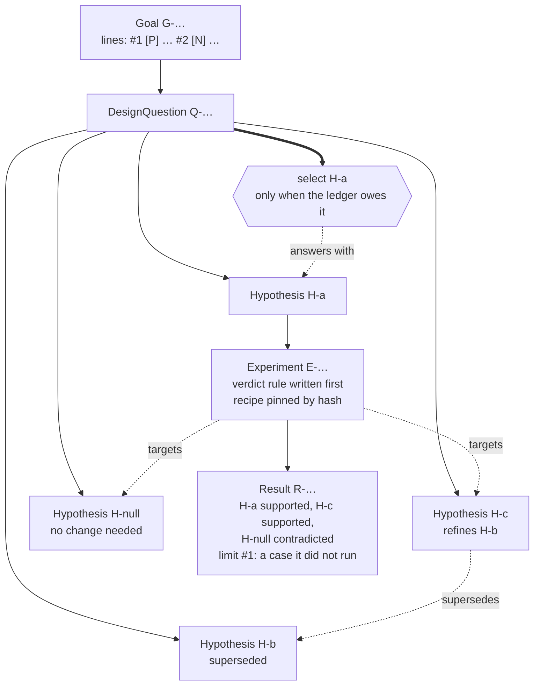
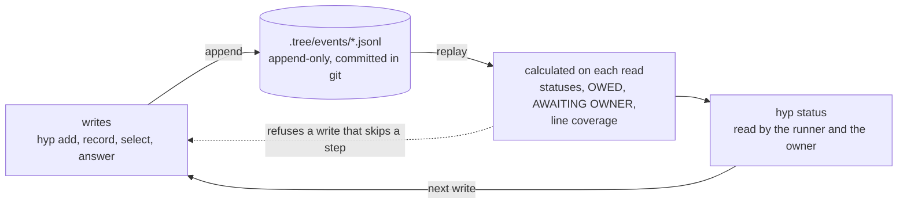

# hyp

Hypothesis-tree memory for AI coding agents. You write your requirements one time, as the lines of a Goal, and each status comes from an append-only log committed with your repo. The agent decides a design and builds it in a tree of rival answers and tests, and hyp keeps the record and shows what is still open.

## Why hyp exists

When an owner gives requirements to an AI coding agent, the work has two phases. First, the agent decides a design. Then, it builds the design. In both phases, the agent decides alone, and it reports in its own words:

- **In the design phase,** the agent usually takes the first design that seems to work. It seldom compares that design with other options, or tests which option meets the requirements. Its reasons stay in notes, plans and chat.
- **In the build phase,** the agent says "done". Its proof stays in the chat: which commit it tested, which check failed before the change and passed after it, and what the review found.

The notes become too long to read, and the next session does not see the chat. A new session cannot find which decisions are made and which decisions are open. Thus it starts again, or it uses a summary that it cannot examine. The owner also cannot examine whether the result meets the requirements.

Other authors already wrote skills for each part of this problem. hyp starts from their skills:

- **[pstack](https://github.com/cursor/plugins/tree/ae5650febf4320793844c12c4adaa937f417f8da/harness/pstack)**, from Cursor. For the record of decisions, its `show-me-your-work` skill keeps an append-only decision log. For the proof that work is done, its `create-verification-skill` skill operates the real app with a fixed procedure and honesty rules.
- **[Matt Pocock's skills](https://github.com/mattpocock/skills)**. For the requirements, their `grilling` skill interviews the user in rounds over a design tree, until the user and the agent have a shared understanding.

These skills work well, and hyp keeps their rules. But each skill solves one part alone. hyp adds what the work needs when the parts must connect, across many sessions and without the owner: one tree for the two phases, with one set of rules:

- **The requirements become the lines of a Goal.** The owner writes the lines one time. Each line is a case that each candidate must meet.
- **In the design phase, a candidate is a claim.** Rival Hypotheses answer each design question, and Experiments separate the rivals.
- **In the build phase, a candidate is a commit.** Each commit is a Hypothesis. An Experiment shows a test that fails on the base and passes on the commit.
- **One ledger controls the two phases.** hyp calculates what is owed and who owes it, and it accepts a decision only when the decision is owed. A build Goal can cite the decisions of a discovery Goal (the Goal of a design phase) in the same store.

Layers 1, 2 and 5 below each name the idea that hyp took, the gap that stays for this purpose, and the rule that hyp adds. Layers 3 and 4 close gaps that hyp found in its own use.

### The tree at a glance

A Goal holds the lines of the owner. Under the Goal, a DesignQuestion holds its rival Hypotheses. An Experiment tests the rivals, and its Result gives a verdict for each rival. The select answers the question:



Each write is an event in a log. hyp reads the full log each time, calculates each status and each owed item, and refuses a write that the ledger does not permit:



### 1. A record that keeps its lineage

The hyp record comes from the pstack skill [`show-me-your-work`](https://github.com/cursor/plugins/blob/ae5650febf4320793844c12c4adaa937f417f8da/harness/pstack/claude-code/skills/show-me-your-work/SKILL.md). That skill keeps a decision log: one TSV row for each decision, with its reason, its evidence and its result. The log is append-only. A new row supersedes a wrong row, and nobody edits or deletes a row.

hyp keeps the append-only log and the supersede rule. But a row has no parent, so the log cannot show which hypothesis started the work, or which answer replaced which answer. hyp closes each gap with one rule:

| In the decision log | The rule in hyp |
|---|---|
| Each row stands alone. | **Rivals are siblings.** Each design question has a minimum of two rival Hypotheses. A refinement is a new sibling that supersedes the old Hypothesis, so the lineage stays visible. |
| A row states its result in words. | **hyp calculates each status.** hyp calculates `supported`, `contradicted`, `stale` and `answered` from the events. No command can set a status. |
| The log is local, and you commit it only when a reviewer needs it. | **The log is the source of truth.** Each write adds an event to an append-only log under `.tree/`. You commit the log with the work. |
| A new session reads the rows to find the current state. | **`hyp status` shows the current state.** A new session does not need a summary. |

### 2. Experiments that you can repeat

The quality of a tree depends on the Experiments that separate its rivals. The hyp Experiment procedure comes from the pstack skill [`create-verification-skill`](https://github.com/cursor/plugins/blob/ae5650febf4320793844c12c4adaa937f417f8da/harness/pstack/claude-code/skills/create-verification-skill/SKILL.md).

That skill makes a verify skill for one project. The verify skill tells an agent how to operate the real app as a user does, and how to prove that a feature works. It has five sections: Launch, Doctor, Drive, Evidence and Cleanup. It also has these honesty rules:

- Evidence stays after cleanup.
- A step that you prove only in a stand-in for the real target stays unverified.
- You must not make a journey easier so that it passes.
- A verify skill that nobody ran is a draft.

hyp keeps the five sections as the steps of a recipe (refer to "Step" in [glossary.md](docs/glossary.md) and [sandbox-spec.md §1](docs/sandbox-spec.md#1-steps-and-commands)), and it keeps the honesty rules. But a verify skill answers one question: "Does this feature work?" A hyp Experiment answers a different question: "Which rival is correct?" Also, a later session must be able to examine that answer. For these two purposes, the verify skill has gaps. hyp closes each gap with one rule:

| In a verify skill | The rule in hyp |
|---|---|
| A proof is about one feature. | **Rivals in one Experiment.** One Experiment tests the rival Hypotheses of a question. Its Result gives a verdict for each rival. |
| The agent decides after the run whether the evidence is a proof. | **A verdict rule before the run.** Each Experiment states which outcome gives which verdict. It states this before it runs ("Verdict rule" in [glossary.md](docs/glossary.md)). |
| The agent runs each command. The record of the run is the report of the agent. | **hyp runs the commands.** hyp runs each recipe command and records each command that it ran ([ADR 0001](docs/adr/0001-hyp-runs-every-recipe-command.md)). |
| The skill changes when the app changes. An old proof does not show which version of the procedure made it. | **Versioned recipes.** A recipe is a bundle of files with a version. A tree pins a recipe by its hash. Nobody edits a pinned recipe; a change is a new version ([ADR 0005](docs/adr/0005-a-bundle-is-its-ref-and-hash.md), [RECIPE-FORMAT.md](skills/hyp-verification/RECIPE-FORMAT.md)). |
| The skill proves itself one time, when the agent makes it. | **Known answers first.** Before each run, the checks of a recipe must give their known answers. A check runs the same way in this gate and in the run ([ADR 0002](docs/adr/0002-known-answers-gate-every-recipe-run.md), [ADR 0003](docs/adr/0003-a-check-runs-the-same-way-in-the-gate-and-in-the-run.md)). |

### 3. A ledger controls each decision

A recorded verdict does not show when a question is complete. An earlier hyp used a verifier: a second reader who confirmed each select. The verifier accepted a wrong verdict, and the owner also accepted it. Now the ledger is the gate ([ADR 0015](docs/adr/0015-the-select-is-the-gate.md)):

- **The owner writes the lines of the Goal.** The owner writes the lines one time. Each line is a case that each candidate must meet. The ledger owes a line on each question until a Result that ran its case covers each candidate there. `hyp status` shows each line as covered or uncovered.
- **A limit is the next case to run.** A Result records the cases that its run did not cover. A later Result closes a limit when it runs the case. When no test in the Goal can run a case, the case goes to the owner. When the Goal does not have a requirement, that requirement becomes a new Goal.
- **The ledger must owe each decision first.** hyp accepts a select only when its ledger owes the select. Thus a question has an answer only after the open work on it is complete. A run stops when the runner owes nothing.

### 4. A build is also a Goal

The build phase uses the same tree as the design phase. The events, the refusals and the ledger are the same. Only the type of candidate is different, and it sets the type of Goal:

| | Discovery Goal | Build Goal |
|---|---|---|
| **The candidate** | A claim: what to build, or why a thing operates as it does. | A commit. |
| **Rivals** | Hypotheses that answer a DesignQuestion. They run against each other. | Each commit is a Hypothesis. A fix supersedes it. |
| **A line** | A case that a check can run on each candidate. | One property of the commit. Its tests or one pinned instrument decide it. |
| **An Experiment** | It separates the rivals, frequently with a pinned recipe and rubric. | It shows red on the base and green on the commit. |

hyp does not store a type. The two types use the same events, refusals and ledger. One store holds many Goals. Thus a build Goal can cite the decision of a discovery Goal ([ADR 0020](docs/adr/0020-one-store-holds-many-goals.md)). A change to the hyp skills is also a build Goal ([how-hyp-improves-itself.md](docs/how-hyp-improves-itself.md)). [glossary.md](docs/glossary.md) defines the two words.

### 5. An owner flow for unattended runs

An unattended run can stop only when the Goal is complete: its lines are clear, and nothing stays that only the owner can answer. The hyp owner flow makes that Goal before the run. Its grill comes from the [`grilling`](https://github.com/mattpocock/skills/blob/7739eaed7f8f3915437a8def198a6d0d7206dbc7/skills/productivity/grilling/SKILL.md) skill of Matt Pocock.

That skill interviews the user about a plan until the user and the agent have a shared understanding. It keeps the decisions as a design tree. The frontier is each decision whose prerequisites are settled. The agent works in rounds:

- Each round asks the full frontier. Each question has a number and a recommended answer.
- The agent finds facts itself, or a subagent finds them. It never asks the user for a fact.
- The decisions are the user's. The agent puts each decision to the user and waits.
- The session is done when the frontier is empty. The agent does nothing until the user confirms the shared understanding.

hyp keeps the rounds, the frontier, the recommended answers and the split between facts and decisions. But the grilling skill makes a shared understanding in one chat. The owner flow must make a Goal that a different session can run without the owner. For this purpose, the grilling skill has gaps. hyp closes each gap with one rule:

| In the grilling skill | The rule in hyp |
|---|---|
| The result is a shared understanding in the chat. | **The grill writes the tree.** The grill records the Goal, its lines and its DesignQuestions in the store. It runs each owner write only after the owner approves the command. |
| The user decides each choice, also a choice that a test can decide. | **A testable choice becomes rivals.** When a run can separate the options, the grill adds a DesignQuestion with a minimum of two rival Hypotheses. The grill does not ask the owner to choose. |
| The agreement does not state what the result must allow or must never allow. | **The grill derives the lines.** Each line is one state that the Goal must allow (`[P]`) or must never allow (`[N]`). When a rejected option can cause a state, that state becomes an `[N]` line. |
| The session is done when the user and the agent agree. | **Done when the tree is complete.** Each question has its place in the tree, and nothing stays that only the owner can answer. |
| The same session acts on the result. | **A separate run, then the owner's answers.** `hyp prompt` prints the `/goal` prompt for a new session. A stopped run leaves its questions under AWAITING OWNER for the owner. |

The flow has three skills. They run in Claude Code, whose `/goal` command keeps a session in operation until its condition is true.

1. **`/hyp-owner-grill`** asks the owner about the purpose until it is a Goal that a run can complete. It ends with the `/goal` prompt that `hyp prompt <G-id> --actor <runner>` prints from the Goal: the tree, the actor, the stop clauses and the constraints block at the end of the Goal body.
2. **`/goal <that prompt>`** runs the Goal with the `hyp-goal-run` skill. The run does only the items that OWED shows for it. It tests before it asks. It stops with a report that the owner can read in `hyp status`.
3. **`/hyp-owner-answer`** shows the owner each item that the stopped run left under AWAITING OWNER. It explains each item and records only the answers of the owner. The next `/goal` run starts from there, with a new prompt from `hyp prompt`. The prompt does not hold the answers, because OWED shows the answers that the run must apply.

## Who does what: what is owed

hyp works from one concept: **owed**. From the log, hyp calculates each item of open work on each question, and the party that owes the item: the runner or the owner. Nobody writes an owed item, and an owed item does not change a status. A party acts on a question when it owes an item there. When nobody owes an item, the question is complete.

| | Owes | Does not |
|---|---|---|
| **Runner** (the agent) | The work that a test can do: rivals, Experiments, Results, limits, readings to apply, premises, stale answers, and the select of a lone candidate. When the runner owes nothing, the run stops with `runner owes nothing: stop and report to the owner`. | Answer for the owner or write a line. |
| **Owner** | The decisions that no test can make: the select when two or more candidates meet each line, an accept or a return of a referred limit, and the answer to an open reading. The owner also writes the lines of the Goal one time, before the work starts. | Run a case, type a verdict or edit a record. |
| **hyp** | Nothing. hyp calculates what each party owes again on each read. It accepts a select only when the party that writes it owes it. It refuses a write that can damage the tree or skip a step. | Decide whether an Experiment has a good design. |

Each item stays owed until an event settles it:

| Item | Owed by | Owed when | An event that settles it |
|---|---|---|---|
| `rivals` | runner | The question has no live rival that is not contradicted. | A new Hypothesis. |
| `untested` | runner | A Hypothesis has no Experiment that tests it. | An Experiment. |
| `undecided` | runner | A Hypothesis is inconclusive, and no planned Experiment tests it. | A planned Experiment, then its Result. |
| `planned` | runner | An Experiment has no Result. | Its Result. |
| `limit` | runner | A Result, or a line of the Goal, has a case that no run covered. | A Result that closes it, or a refer to the owner. |
| `referred` | owner | The runner referred a limit, because no test in the Goal can run its case. | The owner accepts or returns it. |
| `reading` | owner, then runner | A Result has an open reading. The owner owes its answer, and then the runner owes a Result that applies the answer. | The answer of the owner, then a Result that applies it. |
| `premise` | runner | A candidate depends on a Hypothesis that another question did not select. | A new edge, a Hypothesis that supersedes the candidate, or the select of that Hypothesis. |
| `stale` | runner | A selected answer became stale. | A reaffirm, or new evidence that removes the cause. |
| `select` | runner | The question waits on nothing else, and it has one candidate. | `hyp select`. |
| `choose` | owner | The question waits on nothing else, and it has two or more candidates. | The select of the owner, with the words of the owner. |

`hyp status` shows the items that the runner owes under OWED, and the items that the owner owes under AWAITING OWNER. What is owed is calculated per Goal: in a store with many Goals, `hyp status` shows what the runner of each Goal owes. [replay-spec.md §8.1](docs/replay-spec.md#81-ledger-what-the-tree-owes) gives the full rules. [principles.md](docs/principles.md) gives the principles of hyp. They include the role of the owner.

## Examples

hyp's own design is decided and built this way. Both trees below are in this repository; run `hyp status` in their directory to see the same output.

### A discovery Goal

The tree `investigations/id-citation` settled which rule stops a write command from appending text that cites an id that is no node. Its one Result, R-BV4CWV, supported three rivals and contradicted the fourth, and the owner selected among the three as a trade-off. `hyp status` in that directory:

```text
GOAL G-4S36M5 A write command never appends text that cites a node id thi… — complete (answered 1, open 0, reopened 0, deferred 0, withdrawn 0, stale 0)
FRONTIER
STALE
OWED
  runner owes nothing: stop and report to the owner
AWAITING OWNER
RECENT
  2026-11-01 01:51 owner-dat confirm Q-DVZZHY — Owner: sufficient, accept limits #1-#5 of R-BV4CWV
  2026-11-01 01:16 verifier-240-1 confirm Q-DVZZHY — R-BV4CWV: text-refuse exits 2, appends nothing on K1-K6, passes G1-G5; warn and…
  2026-11-01 01:15 claude-240-1 dq.select Q-DVZZHY — Owner chose h-text-refuse over h-text-warn and h-cite after kongming's counsel:…
  2026-11-01 00:26 claude-240-1 result.record R-BV4CWV — e-arms' pre-registered rule (8e5bc68), read from id-citation-arms@1 verdict
CHECKPOINT 2026-11-01 01:51 claude-240-1: Q-DVZZHY answered: h-text-refuse (H-88ZF3E) selected as the owner's trade-off on R-BV4CWV, verifier and owner sufficient. Next: port the rule into internal/cli (exit 2, write-time only), implementing the body (3+ X placeholders, full placeholder word in the message), and rerun the arms recipe with the delivered hyp.
```

The goal is complete and nothing is open. `hyp show Q-DVZZHY` shows how the question was answered (lines selected from its output):

```text
DesignQuestion Q-DVZZHY
title: Which rule stops a write command from appending text that cites an id that is no node?
status: answered
selected: H-88ZF3E (trade-off) — Owner chose h-text-refuse over h-text-warn and h-cite after kongming's counsel: R-BV4CWV supports all three; only refuse keeps the slip out of the log. Check stays write-time, exit 2.
owner: sufficient — Owner: sufficient, accept limits #1-#5 of R-BV4CWV
experiments:
  E-YKJ70D tests H-88ZF3E, H-RAJAFK, H-C5BA8J, H-BMN916
    judged: H-88ZF3E=supports, H-RAJAFK=supports, H-C5BA8J=supports, H-BMN916=contradicts
children:
  H-RAJAFK supported Scan text flags for id-shaped tokens; warn on an unresolved…
  H-88ZF3E supported Scan text flags for id-shaped tokens; refuse an unresolved …
  H-C5BA8J supported request-verify, select and confirm take --result REF, resol…
  H-BMN916 contradicted No change: today's hyp is enough
```

Four rivals were written down before anything ran, including a null rival that said no change was needed. One Experiment tested all four and contradicted only the null. Because the evidence could not choose among the other three, the select is marked as a trade-off the owner made, and the owner's choice ended it.

The tree was recorded with an earlier hyp, and its log keeps what that hyp wrote: a verifier confirmed every select, and the owner's confirm accepted the Result's limits. Both are history. Today the select is the gate, with no verifier ([ADR 0015](docs/adr/0015-the-select-is-the-gate.md)), and the owner accepts a limit only after the runner refers it. A log is never rewritten, so the same events replay the same way.

### A build Goal

`investigations/checkpoint-store-design` recorded the design of the shared store as a discovery Goal, four DesignQuestions the owner settled in a session. `investigations/checkpoint-store` then built it as a build Goal, G-D1CH1R, whose candidate is a hyp commit. Its owner wrote nine lines, eight of them marked `[P]` or `[N]`. `hyp status` there (lines shortened):

```text
GOAL G-D1CH1R hyp implements the shared store: one store holds many Goals — complete (answered 1, ...)
LINES
  G-D1CH1R#1 covered on Q-PC04ED; ran in R-Q7ZZW8, ..., R-RRYBPH — [P] A sto…
  G-D1CH1R#2 covered on Q-PC04ED; ran in R-Q7ZZW8, ..., R-RRYBPH — [N] In a …
  ...
  G-D1CH1R#9 accepted by owner-dat; uncovered on Q-PC04ED: H-P4YGE2 — Each negative-space line has a test pair: …
OWED
  runner owes nothing: stop and report to the owner
```

The one question, Q-PC04ED, asks which commit implements the design. Each commit the runs made is a Hypothesis tied to its base and change, and each fix supersedes the one before: eleven, from `e8dd17c`, whose test failed on the base for the wrong reason and was contradicted, to `4047c01`, which was selected. A self-review in the run recorded its findings as limits of a Result, and later commits closed them. The owner accepted line 9, a fact about history that no test of the commit can assert, and the select was admitted once nothing else was owed.

## Get started

Claude Code is the only harness hyp has been verified on.

**1. Install the binary** (needs Go):

```bash
go install github.com/dat9uy/hyp/cmd/hyp@latest
hyp version
```

**2. Copy the skills into your project** and commit them, so every session in the project loads them. From your project's root, with a clone (or download) of hyp at `<hyp>`:

```bash
mkdir -p .claude/skills
cp -R <hyp>/skills/hyp-* .claude/skills/
git add .claude/skills
```

To update, re-run the `go install` line and copy the skills again, so the binary and the skills stay the same version.

**3. Start a session** in your project and paste this prompt, with the goal and its lines filled in:

```text
Use the hyp-prototype skill. Set HYP_ACTOR=claude-<topic>-1 for this session.
If `hyp status` says there is no .tree store, run `hyp init` at the repository root.
Record this goal with its lines under my actor name <your-name>, showing me
the command first: <the outcome I want, and who needs it>.
Lines: <each case every candidate must meet>.
Add the first design question under it, with at least two rival hypotheses,
one of them "no change needed". Do not add or run experiments yet.
Show me `hyp status` and stop.
```

**4. The lines are yours.** They are the cases every candidate must meet. They come with the Goal and are never added to later, so take your time over them. The session shows you the `hyp add goal` command with your lines and runs it under your actor name once you approve:

```bash
hyp add goal --title "<the outcome>" --actor <your-name> --why "<who needs it>" \
  --line "<a case every candidate must meet>" --line "<another>"
```

Your answers later are `hyp answer` events under the same name, for example `hyp answer --answer "R-…#r1=<your words>"`.

From there the [hyp-prototype skill](skills/hyp-prototype/SKILL.md) guides the next rounds: experiments, verdicts, selects and checks. When `hyp status` lists something under AWAITING OWNER, it is yours to answer. [example.sh](skills/hyp-prototype/example.sh) runs a complete investigation in a throwaway directory.

To run a Goal unattended, use the owner flow (refer to "An owner flow for unattended runs" above).

To work on hyp itself, see [install.md, "Develop hyp"](docs/install.md#develop-hyp).

## What is in this repository

What you install is **core**: the binary (`cmd/`, `internal/`), the skills (`skills/`) and the docs (`docs/`). The **self-review** recipes this repository keeps to test hyp, and the trees in which parts of hyp's own design were decided and built, are kept under `recipes/` and `investigations/`. You need none of them to use hyp. [core-and-self-review.md](docs/core-and-self-review.md) maps every item to its scope.

## Status

hyp is experimental (version 0.1.0, event format v1). One author builds and tests it. Claude Code is the only harness it has been verified on; Codex and pi are untested. The evidence that it works is the trees under `investigations/`, each a recorded investigation with its verdicts and owner choices. Records made before the public release stay in the private development history. hyp itself changes only when a real investigation shows a failure. A change to the binary or the skills is then a build Goal like any other.

## Contributing

Read [AGENTS.md](AGENTS.md). It explains the two scopes, how hyp is improved with hyp, and how to build and test.
