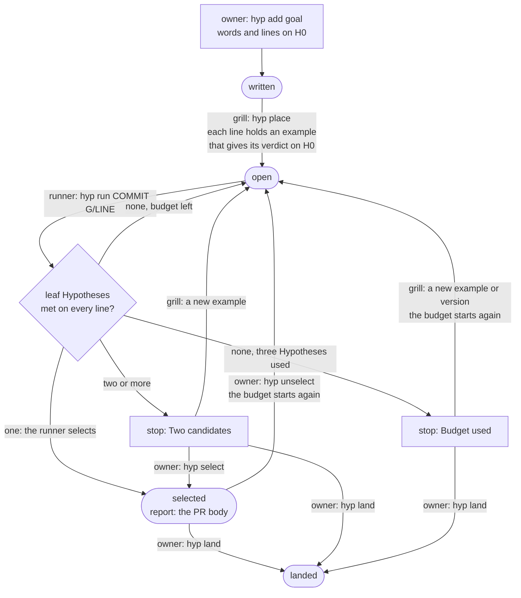

# hyp

Write examples of done first. Each change an AI coding agent makes stays a guess until they pass.

You write a Goal: one sentence of what you want, and the lines that a change must make true or keep true. An agent writes examples for each line: a command, and the text that its output must hold. Each build that an agent offers is a Hypothesis, and hyp runs the examples on it and records each verdict in your repository. A build is selected only when it meets every line, and the report of that select is the PR body.

## Why hyp exists

When you give a change to an AI coding agent, the agent decides alone when the work is done. It says "done" after a check that it chose. Often that check passes on the old code too, so it shows nothing about the change. The agent can also try again and again until a check passes by chance.

The proof stays in the chat: which commit the agent tested, and which check failed before the change and passed after it. The next session does not see the chat. It cannot find which decisions are made and which are open, so it starts again or trusts a summary. You cannot examine whether the result does what you asked.

## The rules hyp follows

hyp moves the decision about "done" out of the agent and into five rules:

- **You state what must be true before any build.** The Goal's lines are written against the base commit, H0. A `gap` line is false on H0, and the build must make it true. A `guard` line is true on H0, and the build must keep it true. The lines are frozen once the Goal opens.
- **An example counts only if it can fail.** hyp runs each example on H0 before it accepts it. A gap example must fail there, and a guard example must be met. A check that gives one answer whatever the code does teaches nothing.
- **Each build is a Hypothesis.** A Hypothesis is the subject of a commit: its files without `goals/` and `.tree/`. hyp keys it by its subject hash, so commits with the same subject are one Hypothesis.
- **Verdicts are recorded and calculated, not argued.** An example is met when its output holds every literal floor and contains no ceiling. hyp records each verdict as an event and calculates every state from the events.
- **hyp stops the loop.** A Goal gets three Hypotheses beside H0. Then, or when a build meets every line, hyp stops the Goal for you.

These rules come from two older ideas. **Specification by Example** agrees on concrete examples before the build and runs them as tests. **Bayes** reads the same loop as belief and evidence:

| In Bayes | In hyp |
|---|---|
| The prior is stated before the evidence. | You state H0 and the lines before any build. |
| Evidence counts only if it could give either answer. | H0 shows that an example can fail. A build shows that it can pass. |
| The update follows a rule. | A literal compare gives each verdict, and hyp calculates each state. |
| Updating never ends by itself. | The budget and the stops end the loop, and the owner decides. |

hyp calculates no probability. A verdict is `met` or `failed`, and a build with no run reads `not run`.

## Credit, and what hyp adds

Other authors already wrote methods and skills for each part of this problem. hyp starts from their work:

- **[Specification by Example](https://www.manning.com/books/specification-by-example)**, the book by Gojko Adzic (Manning, 2011). For the definition of done, the people who want a change agree on concrete examples with the people who build it, and the examples become the tests.
- **[pstack](https://github.com/cursor/plugins/tree/ae5650febf4320793844c12c4adaa937f417f8da/harness/pstack)**, from Cursor. For the record of decisions, its `show-me-your-work` skill keeps an append-only decision log. For the proof that work is done, its `create-verification-skill` skill operates the real app with a fixed procedure and honesty rules. For the states that a change moves through, its `create-formal-verification-skill` and `statechart` skills check a TLA+ model and draw it as a chart.
- **[Matt Pocock's skills](https://github.com/mattpocock/skills/tree/7739eaed7f8f3915437a8def198a6d0d7206dbc7)**. For the owner's wants, the `grilling` skill interviews the user about a plan until the user and the agent share one understanding.

These methods and skills work well, and hyp keeps their rules. But each one solves one part alone. hyp adds what the parts need when they must connect: an agent builds across many sessions, and the owner reads the result at a stop.

### Examples that fail first

From Specification by Example, hyp keeps concrete examples as plain data that the owner reads. From [`create-verification-skill`](https://github.com/cursor/plugins/blob/ae5650febf4320793844c12c4adaa937f417f8da/harness/pstack/claude-code/skills/create-verification-skill/SKILL.md), it keeps a fixed procedure on the real subject and the honesty rules. An agent writes the examples here, so each one must show that it can fail.

| In these sources | The rule in hyp |
|---|---|
| The examples run as tests after the build. | **Each example runs on H0 first.** `hyp place` refuses a gap example that is met on H0, or a guard example that fails there. `hyp try` shows that verdict before the place, and records nothing. |
| The agent decides after the run whether the evidence is a proof. | **The verdict is set before the run.** An example states literal floors and ceilings. Nobody reads the output to decide. |
| The agent runs each command, and its report is the record. | **hyp runs the Probe.** hyp runs the example's Probe on a fresh copy of the commit's subject. It stores each output under `.tree/outputs/` by its sha256. |
| A check can become easier so that it passes. | **An example only becomes stricter.** A new version only adds floors or ceilings. A changed command, input or Probe is a new example. |
| A rerun can give a new answer. | **Two runs on the same bytes give one verdict.** hyp refuses a rerun whose verdict differs, keeps the first verdict, and lists the example as `unstable`. |

### A log that each state comes from

From [`show-me-your-work`](https://github.com/cursor/plugins/blob/ae5650febf4320793844c12c4adaa937f417f8da/harness/pstack/claude-code/skills/show-me-your-work/SKILL.md), hyp keeps the append-only log: a new entry supersedes a wrong one, and nobody edits or deletes an entry. But a later session must find the current state without a summary.

| In the decision log | The rule in hyp |
|---|---|
| A row states its result in words. | **hyp calculates each state.** hyp reads the events on each command and calculates every state. No command sets a state. |
| Each row stands alone. | **Git gives the lineage.** hyp arranges a Goal's Hypotheses by the git ancestry of their commits, the Hypothesis tree. Only a leaf can be a candidate. |
| You commit the log only when a reviewer needs it. | **The log is committed with the work.** Each act appends one event to `.tree/events/<actor>.jsonl`. Git merges two branches of one events file by keeping every line of both. |
| A new session reads the rows to find the next step. | **`hyp status` prints the next acts.** For each role, it prints the allowed acts as ready command lines. |

### A model that finds missing examples

From [`create-formal-verification-skill`](https://github.com/cursor/plugins/blob/ae5650febf4320793844c12c4adaa937f417f8da/harness/pstack/claude-code/skills/create-formal-verification-skill/SKILL.md) and [`statechart`](https://github.com/cursor/plugins/blob/ae5650febf4320793844c12c4adaa937f417f8da/harness/pstack/claude-code/skills/statechart/SKILL.md), hyp keeps the TLA+ model of a change, the rule that a check must be shown to fail on a broken variant, and the Mermaid chart. The [hyp-statechart](skills/hyp-statechart/SKILL.md) skill ships the `statechart` tool with its MIT license and [its source](skills/hyp-statechart/SOURCE). In hyp, the model does not prove the code. It finds other builds, potential Hypotheses, that the examples do not separate from the one under test.

| In these skills | The rule in hyp |
|---|---|
| The model checker gives the verdict on the model. | **Only the examples count at the select.** hyp runs no model checker. The model is in `goals/<G>/specs/`: a `.tla` module, its check config, one switch config per potential Hypothesis, and `chart.mmd`. |
| Each property fails on a broken variant of the code. | **Each switch is tried as a patch.** The grill writes each switch's build as a patch and runs the examples on it with `hyp try --worktree`. A patch that meets every example goes to the owner with its outputs, and the owner chooses which output is wanted. |
| The verify skill leaves the check for the next agent. | **The select checks the model.** hyp refuses a select while a rule of the check config has no switch config that names it, or while the folder holds no chart. |
| The chart goes to the reader. | **The PR body prints the chart.** The report of the select holds each chart of the spec folder in a `mermaid` block. |

### A grill that leaves a Goal for another session

From [`grilling`](https://github.com/mattpocock/skills/blob/7739eaed7f8f3915437a8def198a6d0d7206dbc7/skills/productivity/grilling/SKILL.md), the [hyp-grill](skills/hyp-grill/SKILL.md) skill keeps the split between facts and decisions: the agent finds facts, and each decision stays the owner's. But a runner in a different session must work the Goal without the owner.

| In the grilling skill | The rule in hyp |
|---|---|
| The result is a shared understanding in the chat. | **The grill writes the examples.** The grill drafts the words and the lines, and the owner records the Goal. The grill writes each example and places it. |
| Each decision is in the chat. | **A decision is the words, a line or an example.** The grill lists each decision that no example checks under "Not covered", and never gives it to the runner as an extra rule. |
| The agent asks about the plan. | **Product questions only.** The grill asks what the owner wants to be true, never how to build it. |
| The same session acts on the result. | **A separate runner, with run rules.** A runner in another session works the Goal, with [run-rules.md](skills/hyp-grill/run-rules.md), the rules that hyp cannot check. |

## How a Goal runs

The owner records a Goal, the grill places its examples, and the runner runs builds until hyp calculates a stop. Each stop waits for the owner:



A Goal is `written`, `open`, `selected` or `landed`, and hyp calculates the state from the events. The select records only a candidate: a leaf Hypothesis that meets every line. With one candidate the runner selects it. With two or more, only the owner selects, and the owner may select a candidate at any time. hyp also refuses a select of a commit with no spec under `goals/<G>/specs/`.

Four roles act. The actor and the role are declared by the agent, and a guard that reads them catches an honest mistake, not a lie.

| Role | Does | Acts |
|---|---|---|
| **owner** | Records the words and the lines. Selects between candidates. Ends the Goal, or opens a selected Goal again. | `hyp add goal`, `hyp select`, `hyp land`, `hyp unselect` |
| **grill** | Asks the owner product questions. Writes the examples, and places them on the lines. | `hyp place` |
| **probe-writer** | Writes Probe code for an example. Records no event. | none that writes |
| **runner** | Builds commits, runs each line on them, and selects the one candidate. | `hyp run`, `hyp select` |

hyp itself is not a role. It runs each Probe, calculates each state, and refuses an act whose guard fails, with exit 1 and the guard's name. `hyp status`, `hyp try`, `hyp show` and `hyp prune` are reads: they record nothing in the repository. The spec also states `reset` and `retract`, which later Goals will build.

### Example: G-H7GGGK

Goal G-H7GGGK added the hyp-grill skill. Its words are "A grill skill that ships with hyp", and it has one gap line: "A user of hyp in another repository can grill and re-grill a Goal with no prompt written by hand." The grill placed three examples on the line. Each one runs a check script over the skill folder. On H0, `f93b747`, the folder did not exist, so each example failed. Part of the output of `line-1/a` on H0:

```text
skill folder hyp-grill: no
rule option-label-is-the-recorded-text: no
```

The runner ran the line on one Hypothesis, commit `84fc46e`. Each example was met there, so it was the one candidate, and the runner selected it. `hyp status G-H7GGGK` prints:

```text
G-H7GGGK  selected  runs: 1 of 3 used
stop: selected, by select 01M7VJY97WYEK53FKKE0HGYHHM at 2026-11-20T04:20:24.44407Z
```

[PR #250](https://github.com/dat9uy/hyp/pull/250) holds the full report of the select as its body: each example's words, output, stderr, exit code and verdict, and the selected commit and row.

## Get started

Claude Code is the only harness hyp has been verified on. hyp needs Go to install, and `git` with a `sha1` repository to run.

**1. Install the binary:**

```bash
go install github.com/dat9uy/hyp/cmd/hyp@latest
hyp version   # hyp 0.2.0-dev (events v2)
```

**2. Copy the skills into your project** and commit them, so each session loads them. From your project's root, with a checkout of hyp's `main` at `<hyp>`:

```bash
mkdir -p .claude/skills
cp -R <hyp>/skills/hyp-grill <hyp>/skills/hyp-statechart .claude/skills/
git add .claude/skills
```

**3. Grill the Goal.** Start a session in your project with `HYP_ACTOR` set to a name for the agent and `HYP_ROLE=grill`. Ask it to use the hyp-grill skill on your problem. It asks you product questions and drafts the words and the lines.

**4. Record the Goal yourself.** The words and the lines are frozen when the Goal opens:

```bash
export HYP_ACTOR=<your-name> HYP_ROLE=owner
hyp add goal --base HEAD --words "<one sentence>" \
  --line "gap:<what the build must make true>" \
  --line "guard:<what the build must keep true>"
```

The first `hyp add goal` makes the store, `.tree/`, at the top level of the repository. Commit `.tree/` with the work. The grill then places the whole example set with the one place line that `hyp status <Goal> --role grill` prints, `hyp place <Goal>`.

**5. Run the Goal.** Give a runner session [run-rules.md](skills/hyp-grill/run-rules.md) and `HYP_ROLE=runner`. The runner runs only the lines that `hyp status <Goal> --role runner` prints. When hyp stops the Goal for you, `hyp status` shows why, and `hyp help` lists every command.

[docs/install.md](docs/install.md) has the full setup, and [docs/owner-guide.md](docs/owner-guide.md) tells you what to do at each stop.

## Read next

- [docs/state-machine.md](docs/state-machine.md): the one spec of every rule. When another page differs from it, the spec wins.
- [docs/glossary.md](docs/glossary.md): the words hyp uses.
- [docs/owner-guide.md](docs/owner-guide.md): what the owner sees and answers.
- [docs/principles.md](docs/principles.md): why hyp is shaped the way it is.
- [AGENTS.md](AGENTS.md): how hyp is changed with hyp, and how to build and test it.

## Status

hyp is experimental: version 0.2.0-dev, events v2. One author builds and tests it. Claude Code is verified; Codex and pi are untested. The Goals that changed hyp itself are under [goals/](goals/), and `hyp status` prints each one.

hyp 0.1.0 (events v1) used a different model. Its skills and records are kept on the `v1` branch.
