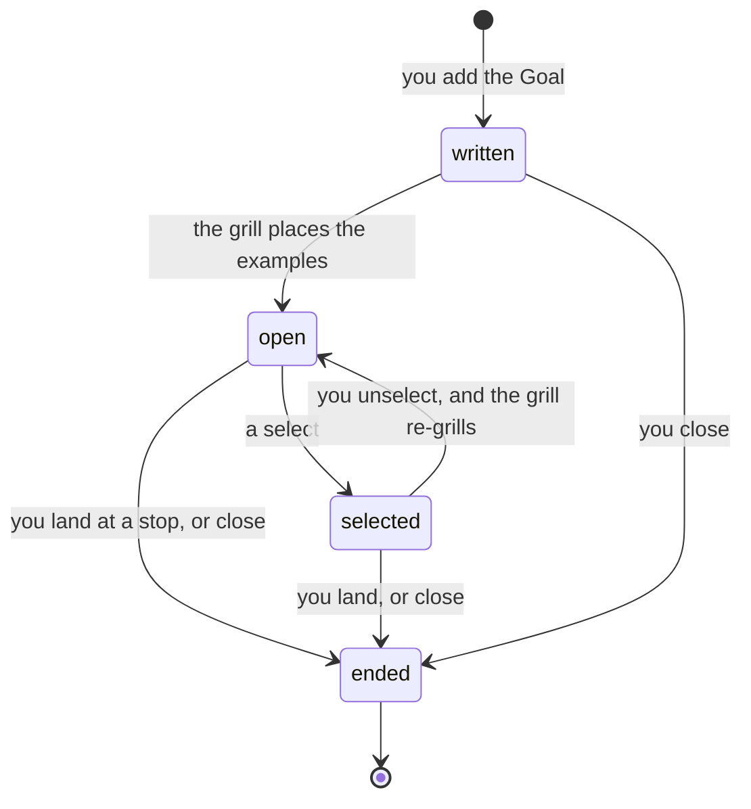

# Owner guide

You are the owner of a Goal when you add it. This guide tells you how to use the two skills and the flow of a Goal: first the hyp-grill skill, then the run, then you land, close or re-grill. Read the [README](../README.md) first: it says what a Goal, a line, an example and a Hypothesis are. [glossary.md](glossary.md) defines each word. The rules are in the binary: `hyp spec` prints every state, act and guard, and `hyp status G --role owner` prints the acts you may take now.

## What you decide

hyp gives four decisions to you, and to no agent:

- **What must be true.** The Goal's words and lines, against the base commit H0, are the only wants that the agents work toward.
- **Which build you want.** When two builds meet every line, only you select.
- **When the Goal ends.** You land it at a stop, or you close it at any time.
- **What merges.** hyp writes nothing to GitHub. You merge each PR yourself.

You read examples and their outputs, not code. You read code only at the merge, where you can reject how the build works.

## The flow



### 1. The grill: the hyp-grill skill

A real event, such as a refusal or a run you flag, starts an issue. Start a session with the [hyp-grill](../skills/hyp-grill/SKILL.md) skill and give it the issue.

- The grill asks you only what you want to be true, never how to build it. Each question gives options. Each option has a label and a description of what the runner then builds. You answer with a label.
- The grill drafts the `hyp add goal` command with your actor. You run it yourself:

  ```bash
  export HYP_ACTOR=<your actor> HYP_ROLE=owner
  hyp add goal --base <H0 commit> --words "<one sentence>" \
    --line "gap:<what the build must make true>" \
    --line "guard:<what the build must keep true>"
  ```

- The grill writes the examples and runs each one on H0. A gap example must fail on H0, and a guard example must be met on H0. When the change moves through states, the grill also writes a model and its chart with the [hyp-statechart](../skills/hyp-statechart/SKILL.md) skill. When two builds meet every example and print different things in one case, the grill shows you the case and what each build prints. You choose the output you want.
- The grill places the examples, and the Goal opens. Its hand-off lists your decisions and a part "Not covered": each want that no example checks. No runner gets a "Not covered" item as a task.
- You merge the record PR, which holds the Goal, its examples and the model. The examples then reach the runner's commits.

### 2. The run

`hyp status G` prints the runner's Start prompt of an open Goal, ready to copy. Start a runner session and give it that prompt, and nothing else. The prompt names no issue: you close the issues the Goal settles. The runner follows the run rules of the hyp-grill skill.

- Each build that the runner offers is a Hypothesis. The budget is three Hypotheses after H0.
- With one candidate, a build that meets every line, the runner selects it. The select's report is the PR body: each line, each example's words, output, exit code and verdict, each chart of the model, and the selected commit.
- You may select a candidate at any time. You do not have to wait for the runner.

hyp stops the run and waits for you at a stop:

- **Selected.** Read the PR body. Read each output against what you meant, not only its verdict.
- **Two candidates.** Two builds meet every line. `hyp status G --role owner` prints the outputs of each build and a `hyp select` line for each one. Select the build you want, or have the grill place an example that fails the other.
- **Budget used.** Three Hypotheses ran and none meets every line. `hyp status G --role owner` prints the outputs table. A cell shows only the start of the first line: open `outputs/<hash>` in the trace of the clone that ran it to read every byte.

### 3. You land, close or re-grill

- **Land.** `hyp land G` ends the Goal at its stop. Merge the runner's PR before the land, after it, or not at all: the land checks no commit. The landed Goal is a snapshot of your decision, and a later Goal can cite it with `--from G`.
- **Close.** `hyp close G` ends a Goal that you will not go on with, at any stop or none. The closed Goal keeps its rows and verdicts, and a later Goal can cite it with `--from G`, as it cites a landed one.
- **Re-grill.** When your review finds a gap in a selected Goal, run `hyp unselect G`. The Goal is open again, each Hypothesis and verdict stays, and the budget starts again. Start a hyp-grill session on the Goal. The grill places an example on an existing line, and the runner runs again. At Budget used, the grill can also re-grill an example: a new version only adds a floor or a ceiling, and it gives the runner three new Hypotheses.

A gap that needs a new line is a new Goal. Land or close this Goal, then add a new Goal with `--from G`. An ended Goal takes no write.

## What you read

`hyp status G --role owner` prints the state block of one Goal:

- **The first line**: the Goal, its state and the Hypotheses used. H0 is not counted.
- **`stop:`**: the stop, the act that caused it and when, or `none`.
- **`waits:`**: `grill` while the Goal is written, `owner` at a stop, else `none`.
- **`owner may:`**: each act that you may take now, as a command line ready to run.
- **`landed:`** or **`closed:`**: on an ended Goal, which end it was, by whom and when.
- **`refused at replay:`**: a merged log broke a rule. hyp skips that event and keeps it in the log. A run that another clone wrote before your end and that reached your log after it is listed here, so the ended Goal shows the same rows in every clone.

`hyp show <actor>` prints what hyp printed to that actor, byte for byte. Use it to read what the runner saw.
