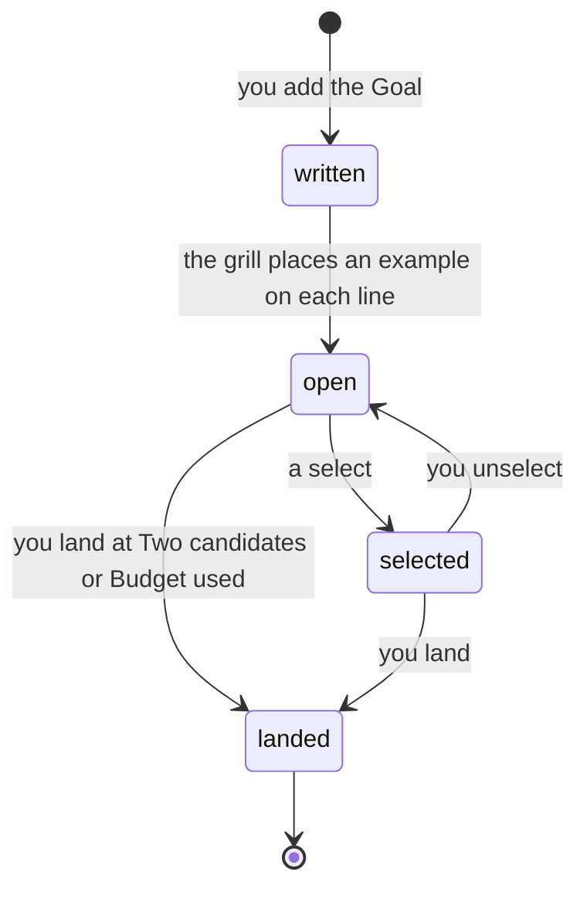

# Owner guide

You are the owner of a Goal when you add it. This guide tells you what you do, what you read and what you decide, from the issue to the land. Read the [README](../README.md) first: it says what a Goal, a line, an example and a Hypothesis are. [glossary.md](glossary.md) defines each word. [state-machine.md](state-machine.md) is the one spec of the rules, and when this guide and the spec disagree, the spec wins.

## What you decide, and why it matters

An agent that builds a change can also say when the change is done. hyp takes that decision away from the agent and gives it to you, in four parts:

- **You state what must be true, before any build.** The Goal's words and lines, against the base commit H0, are the only wants the agents work toward. An agent can show you a gap and ask you. Only your act adds a want.
- **An example counts only if it can fail.** hyp runs each example on H0 before it accepts the example. So a verdict on a build can show a real change from H0.
- **Verdicts are calculated, not argued.** A literal compare of the output gives `met` or `failed`. When a verdict seems wrong to you, the fix is a better example, not a discussion.
- **You decide at the stops.** hyp stops the loop and waits for you. Only you choose between two candidates, accept a build with a merge, and end a Goal with a land.

You read examples and their outputs, not code. You read code only at the merge, where you can reject how the build works.

Four roles act: owner, grill, Probe writer and runner. hyp is not a role: it runs each Probe, calculates each state and refuses an act that breaks a rule. Only the actor that added a Goal can select for the owner, unselect or land that Goal. hyp does not authenticate actors, so this rule catches an honest mistake, not a lie.

## The life of a Goal

A Goal is `written`, `open`, `selected` or `landed`. hyp calculates the state from the events, and you never set it:



**1. The grill asks, and you answer.** A real event, such as a refusal or a run you flag, starts an issue. A session with the [hyp-grill](../skills/hyp-grill/SKILL.md) skill asks you questions about that issue. It asks only what you want to be true, never how to build it. Each question gives options with a short label and a description of what each option makes the runner build. You pick by the label, and the label is the text that the grill records. When you correct a draft, the grill shows it again and waits for your consent. The grill writes each of your decisions to the issue, in your words. A record cites only an issue, a PR or a commit.

**2. You add the Goal.** The grill switches to a record branch and drafts the command with your actor. You run it yourself:

```bash
export HYP_ACTOR=<your actor> HYP_ROLE=owner
hyp add goal --base <H0 commit> --words "<one sentence>" \
  --line "gap:<what the build must make true>" \
  --line "guard:<what the build must keep true>"
```

A Goal has one to ten lines and a minimum of one gap line. The Goal is `written` and `waits: grill`. While it is written, `hyp add goal G …` replaces it. After it opens, its words and lines are frozen, and a new line is a new Goal.

**3. The grill places the examples and hands off.** The grill writes each example and runs it on H0. A gap example must fail there, and a guard example must be met. The Goal opens when each line holds such an example. When the change moves through states, the grill also writes a model and its chart with the [hyp-statechart](../skills/hyp-statechart/SKILL.md) skill. The statechart tool says which rules each variant of the model breaks and which examples each variant would meet. The grill tries each variant the tool predicts to meet every example as a patch: a potential Hypothesis, a different build that hyp has not recorded. When a tried patch meets every example and prints something else in a case no example covers, the grill asks you one plain question about that case and shows what each build prints. You choose which output you want, or say either output is fine. The grill then places an example that separates them, or lists the choice under "Not covered".

The hand-off lists your decisions and a part named "Not covered". Each item there is a want that no example checks. The runner never gets it as a task, so a "Not covered" item can stay false in the build.

**4. You merge the record PR.** The record PR holds the Goal, its examples, their place events and the model. Merge it before the runner runs, so the examples reach the runner's commits.

**5. The runner runs.** You start a runner session with [run-rules.md](../skills/hyp-grill/run-rules.md). Each build that the runner offers is a Hypothesis, keyed by its subject hash. The budget is three Hypotheses after H0. A candidate is a Hypothesis that meets every line and has no Hypothesis built on it. With one candidate, the runner selects it. You may select a candidate at any time, and you do not have to wait for the runner.

**6. You read the select report.** The report of the select is the PR body. It shows each line, and each example's words, verdict, exit code, output and stderr. It prints each chart of the model in a `mermaid` block, under `## Chart: goals/<G>/specs/chart.mmd`. It ends with the selected commit and row. Read each output against what you meant, not only its verdict. The PR can also name potential Hypotheses that meet every example, with their outputs. When you want one output and not the other, unselect the Goal and have the grill place an example that separates them.

**7. You merge the runner's PR, and you land the Goal.** Nothing merges by itself, and hyp writes nothing to GitHub. `hyp land G` records your decision and ends the Goal. It checks no commit, so you can land before the merge, after it, or with no merge. The landed Goal is a snapshot of your decision. A later Goal can cite it with `--from G`.

## What `hyp status` shows

`hyp status G` prints the state block of one Goal. This is the real output for G-H7GGGK, which is selected, with its PR body cut:

```text
G-H7GGGK  selected  runs: 1 of 3 used
stop: selected, by select 01M7VJY97WYEK53FKKE0HGYHHM at 2026-11-20T04:20:24.44407Z
waits: owner
owner may:
  hyp land G-H7GGGK
  hyp unselect G-H7GGGK
grill may:
  (none)
probe-writer may:
  (none)
runner may:
  (none)

PR body:

# G-H7GGGK: A grill skill that ships with hyp
…
selected commit: 84fc46ea7054a2f9116b10039f735a0f488ffb75
selected row: 8326335b3416ae83ee1cab190b66a82965950e89
```

- **The first line** gives the Goal, its state and the Hypotheses used. H0 is not counted.
- **`stop:`** names the stop, the act that caused it, its event id and its time. It is `none` when the Goal has no stop.
- **`waits:`** is `grill` while the Goal is written, `owner` at a stop, and `none` otherwise.
- **`<role> may:`** lists each act that a role may take now, as a command line ready to run. `--role owner` shows only your acts.
- **`landed:`** follows `stop:` on a landed Goal, for example `landed: by owner, land 01M7WJSTFC9FX8WGA0CRM50H4M at 2026-11-20T13:37:12.684825Z`.

The block can hold more lines:

| Line | Means |
|---|---|
| `last run: after this, G stops for the owner.` | The runner used two of three Hypotheses. |
| `split: <line> on row <subject hash>` | The examples of one line give different verdicts on one Hypothesis. |
| `unstable:` | A repeat run on the same bytes gave another verdict. hyp keeps the first one. The example needs the grill. |
| `refused at replay:` | A merged log broke a rule. hyp skips that event and keeps it in the log. |
| `not read at replay:` | A line of an events file does not parse, for example a line torn by a crash. hyp names its file and line number, skips it and keeps it in the log. Every block lists it, because the line names no Goal. |
| `outputs:` | At Two candidates or Budget used: each example's verdict and output on each Hypothesis. |

`hyp show <actor>` prints what hyp printed to that actor, byte for byte. Use it to read what the runner saw.

## At each stop

Each stop waits for you, and `hyp land G` is among your acts at each one. hyp prints the outputs, not a reading of them: no score and no summary.

### Selected

You read the PR body. Your acts are the two lines that hyp prints:

```text
owner may:
  hyp land G-H7GGGK
  hyp unselect G-H7GGGK
```

Merge the PR and land, or unselect when your review finds a gap (see [When your review finds a gap](#when-your-review-finds-a-gap)).

### Two candidates

Two or more Hypotheses meet every line, and none is selected. Only you can select now. This is the real output of `hyp status G-YNGYCD --role owner` for a small demo Goal, cut after its first two rows:

```text
G-YNGYCD  open  runs: 2 of 3 used
stop: two candidates, by run 01M7WQRF6DSBH5G28BCGXJXRQR at 2026-11-20T15:03:51.245311Z
waits: owner
owner may:
  hyp select G-YNGYCD 1051b308294c7006204f0f3a6dc0b29e0f253b02
  hyp select G-YNGYCD 4082e81ad23e01e00ecbf43e916b7624feaa6add
  hyp land G-YNGYCD
outputs: each cell shows at most 60 characters of the output's first line; all its bytes are in ~/.hyp/traces/<key>/outputs/<hash>, or in .tree/outputs/<hash> for an older log
  row b73ce8eb02bc4ea2f6747ed4074aca68f17a4c3a
    line-1/a  failed  exit 0  3c6ac18a67305bf96690d803fc1843912c72a2f2f2edabd2159133a62933f7f6  15 bytes: greeting: hello
    line-2/a  met  exit 0  3c6ac18a67305bf96690d803fc1843912c72a2f2f2edabd2159133a62933f7f6  15 bytes: greeting: hello
  row 1051b308294c7006204f0f3a6dc0b29e0f253b02
    line-1/a  met  exit 0  6e0bbcf07d2f8f455a49d00679345a65ccc9663886c4653acad812108fdcd53f  19 bytes: greeting: hello Ann
    line-2/a  met  exit 0  6e0bbcf07d2f8f455a49d00679345a65ccc9663886c4653acad812108fdcd53f  19 bytes: greeting: hello Ann
```

The first row is H0. Compare the outputs of the candidates. You have three choices:

- Run the `hyp select` line of the build you want.
- Ask the grill for an example that fails the build you do not want. The grill can place it now.
- Land the Goal with no select.

hyp prints a select line only for a candidate whose commit holds a spec under `goals/<G>/specs/`.

### Budget used

Three Hypotheses ran since the boundary, and none meets every line. The boundary is the latest example change or unselect. Your only printed act is `hyp land G`, and the grill may place. This is the real output of a second demo Goal, with the other roles, the `outputs:` heading and the first three rows cut:

```text
G-728VFW  open  runs: 3 of 3 used
stop: budget used, by run 01M7WQS2EMW66EF80KTDNH0X2F at 2026-11-20T15:04:10.964873Z
waits: owner
owner may:
  hyp land G-728VFW
…
  row 39532ee6a007642933f46ac660c4b60c8bb20f53
    line-1/a  failed  exit 0  783603eb11e541b41f39290571f2901c1e180b375f1ef7ae339c62d98d192a96  14 bytes: total: 2
```

A cell shows only the first line. The last row prints `total: 2`, but its 14 bytes hold a second line, and the `floor: equals` fails on it. Open the output file the header names to read every byte. Then choose:

- **The example is wrong.** Have the grill re-grill it. A new version of an example only adds a floor or a ceiling. A changed run, input or Probe is a new example key. Each such placement moves the boundary, so the runner gets three new Hypotheses. A floor that fails a build you accept is too strict. A new version cannot loosen it, and the example stays in the set, so its line can never be met: land the Goal, as below.
- **The Goal is wrong.** Land it, and add a new Goal with `--from G`.

The spec also gives you a reset of the budget, but hyp does not have it yet.

## When your review finds a gap

**Before the land, unselect.** A selected Goal refuses every new example. `hyp unselect G` puts it back to `open`:

```text
unselected G-YNGYCD
undid: select 01M7WQSA0EZRNGP9VCP00NKB66 at 2026-11-20T15:04:18.702886Z, commit 007c5aa882d369067b07b3d5d68abe9f71bdeff6, row 4082e81ad23e01e00ecbf43e916b7624feaa6add
G-YNGYCD  open  runs: 0 of 3 used
```

Each Hypothesis and verdict stays, and the budget starts again. The grill then re-grills: you choose which output you want, and the grill places an example on an existing line that separates the two builds. The runner selects again only after a run records new evidence: a new example version or a new Hypothesis. A rerun on the same bytes is not new evidence. You may select again immediately. When main moved after the select, unselect and have the runner run the line on the merge commit, then select.

**A gap that needs a new line is a new Goal.** Land this Goal, then add a new Goal that cites it with `--from G`.

**After the land, the Goal takes no write.** A gap that you find later is a new Goal, with `--from G`.

## What hyp does not have yet

Each item below is in the spec but not in the binary. `hyp help` lists every command that the binary has, and `hyp status` offers only those.

- **`reset`**, which gives the budget back with no example change. `hyp help` does not list it, and `hyp reset` prints the usage, exit 2.
- **`retract`**, which takes back a wrong run. `hyp help` does not list it, so each verdict of a wrong run stays.
- **An end for a Goal with no stop.** `land` needs a stop, so a Goal that never reaches one stays open ([spec §14](state-machine.md#14-deferred)).
- **A chart of each Hypothesis at a stop.** At Two candidates and Budget used you read only the `outputs:` table ([spec §11](state-machine.md#11-budget-and-stops)).
- **A runner that hyp starts.** You start the runner session yourself. The grill can write its prompt when you ask.
