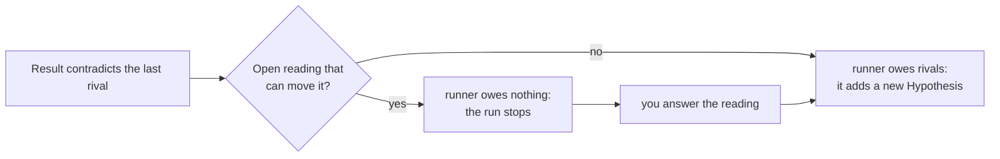

# Owner guide

You are the owner of a Goal when you write its lines and answer what hyp asks you. A runner does the work: it adds Hypotheses, runs Experiments and records Results. hyp calculates every status from the events, and it tells each party what it owes. This guide tells you what hyp asks of you, when a run stops for you, and which command records each answer.

The words in this guide have one meaning each. [glossary.md](glossary.md) defines them, and [principles.md](principles.md#7-who-does-what) states your role as rules.

## What you do

- **You write the Goal one time.** Its lines are the cases that every candidate must meet. hyp never edits a Goal. A new line or a new purpose is a new Goal, which can be in the same store.
- **You answer what hyp gives you, and nothing more.** hyp asks you only when no test in the Goal can decide. It asks you only when the runner owes nothing on that question.
- **Your answer changes no status.** A status changes only through the verdicts of a Result. Your answer has an effect when a later Result applies it.
- **You produce no evidence.** You never run a case, give a verdict, record a limit or tie a subject. The runner does these.

hyp does not authenticate actors. An answer under your actor name shows that someone wrote it with that name. That you agreed to it depends on how your team works.

## How hyp sorts the Hypotheses

Each Hypothesis has one status at a time. The sets below are nested: each set is the set above it, plus one property. Your decisions are about the two smallest sets.

| Status | Hypothesis | live | rival | candidate |
|---|---|---|---|---|
| `superseded`, `abandoned` | ✓ | | | |
| `contradicted` | ✓ | ✓ | | |
| `proposed`, `inconclusive` | ✓ | ✓ | ✓ | |
| `supported` | ✓ | ✓ | ✓ | ✓ |

- **Live** means not superseded and not abandoned.
- **Rival** means live and not contradicted. A rival can still win.
- **Candidate** means a rival that is supported. Only a candidate can become the answer to its question.
- **Sibling** means another Hypothesis of the same question, with any status.

A contradicted Hypothesis is never a candidate. When a Result contradicts a candidate, it leaves both sets at once. In a build Goal, each commit is a Hypothesis, and a fix is a new Hypothesis that supersedes the old one.

The number of candidates sets who acts next:

| Candidates on a question | Next step | Who |
|---|---|---|
| None, and no rival is left | add a new Hypothesis (the `rivals` item) | runner |
| None, but a rival is untested or undecided | run an Experiment on it | runner |
| One | record the select | runner |
| Two or more | choose one (the `choose` item) | you |

## When a run stops for you

hyp keeps a ledger: a list of the open work on each question and the party that owes it. hyp calculates the ledger from the events each time you read it. `hyp status` prints the runner's items under OWED and your items under AWAITING OWNER.

A run continues while the runner owes an item. When it owes nothing, OWED ends with this line, and the run stops:

```text
runner owes nothing: stop and report to the owner
```

Three things can stop the runner and give the next step to you:

- **An open reading whose answer can move a Hypothesis.** A reading records how a run read your words, when a line can mean two things. While it is open, hyp holds back the `rivals`, `select` and `choose` items on its question. The reason is that your answer can change which Hypotheses stay in the race: a new Hypothesis written before your answer can be built on the wrong meaning.
- **A referred limit.** The runner says that no test in the Goal can run a case, or that the case does not apply to any candidate. The question waits for your accept or your return.
- **Two or more candidates.** hyp cannot choose between designs that both meet every line. You choose.

A reading that no answer can change holds nothing back. It still prints under AWAITING OWNER, and the runner continues to work.



## What you answer, and how

Run each command in the store's directory, under your own actor name.

| What waits for you | What it asks | Command |
|---|---|---|
| An open reading, key `R-…#rN` | What do your words mean? | `hyp answer --answer "R-…#rN=<your words>" --actor <you>` |
| A referred limit, key `R-…#n` or `G-…#n` | Does this Goal run the case? No. | `hyp answer --accept "<key>=<your words>" --actor <you>` |
| A referred or accepted limit | Does this Goal run the case? Yes. | `hyp answer --returns "<key>=<your words>" --actor <you>` |
| `choose: H-…, H-…` | Which candidate? | Tell the runner. It records `hyp select <Q> <H> --why "<your words>"` |

- **An answer has no `--why`.** Your words in each item are the reason. hyp refuses `--why` on `hyp answer` with exit 2.
- **One answer can hold many keys.** Repeat the flag for each key, also for keys of other Goals in the same store.
- **To change an answer, answer the reading again.** The new words apply from then on. The earlier answer stays in the history, and no earlier verdict changes.
- **An accept takes the case out of this Goal only.** A later Goal can take the case: one of its lines cites the accepted key.

## After you answer

Your answer creates work for the runner, and the next run does it:

- An answered reading becomes the runner's `apply answer` item. A Result applies it with `--applies` and gives new verdicts.
- A returned limit becomes the runner's `limit` item again. A Result runs the case and closes the limit.
- When no rival is left, the runner adds a new Hypothesis. Its Experiment runs the open limits and applies your answers.

The Goal is complete when every live question under it has an answer. Your Goal is met when it is complete and OWED shows no line of it.
